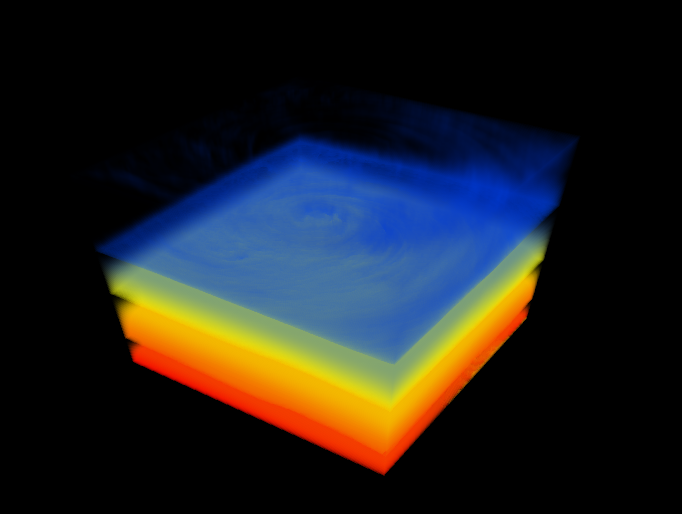
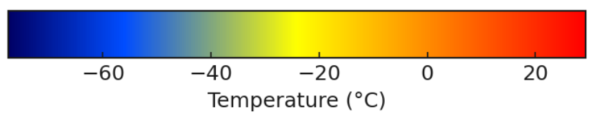
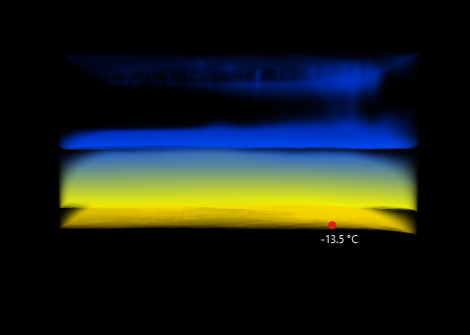
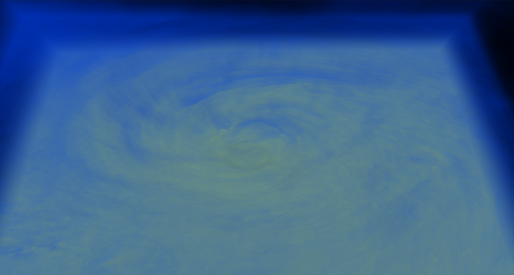

# 3D Volumetric Visualization of Hurricane Isabel

A GPU-accelerated **Direct Volume Rendering (DVR)** desktop application built with Python, PyOpenGL, GLSL, and PySide6 (Qt). The tool visualizes 3D atmospheric temperature fields from a high-resolution Weather Research and Forecasting (WRF) simulation of **Hurricane Isabel** (2003).




## Key Features

* **GPU Raymarching Engine:** Custom OpenGL 3.3 Core vertex and fragment shaders (`GLSL`) performing raymarching across a `sampler3D` volume texture with front-to-back alpha compositing and **early ray termination** for real-time interaction.
* **Custom RGBA Transfer Function:** Piecewise linear color and opacity mapping transitioning from cold upper-atmosphere layers (blue) to warm surface layers (yellow, orange, red) to highlight thermodynamic structures of the hurricane.
* **Interactive Threshold Filtering:** A dedicated PySide6 control panel with synchronized sliders allowing real-time filtering of minimum and maximum temperature thresholds (in °C).
* **Real-Time Scalar Inspection HUD:** Performs CPU ray-box intersection and raycasting on mouse hover to back-transform normalized voxel values and display exact local temperatures (°C) in a floating overlay.
* **Full 3D Camera Navigation:** Smooth spherical orbiting, view panning, zooming, and instant view reset.

## Visual Showcase

| Threshold Filtering & Scalar HUD (`-13.5 °C`) | Close-Up of the Hurricane Vortex Structure |
| :---: | :---: |
|  |  |

## Architecture

The application is structured into three main components inside `main.py`:

* `MainWindow`: Configures the OpenGL 3.3 Core surface format and integrates the rendering viewport with the floating control window.
* `GLVolumeWidget`: Manages the OpenGL context, compiles GLSL shaders, uploads the normalized 3D NumPy array to a 3D GPU texture, and handles camera matrices and mouse/keyboard events.
* `ControlPanel`: Provides the Qt slider UI to dynamically adjust rendering thresholds and update shader uniforms in real time.

## Dataset

The project uses meteorological simulation data from the [Earth System Grid (Hurricane Isabel Dataset)](https://www.earthsystemgrid.org/dataset/isabeldata.html):

* **Variable:** Atmospheric Temperature (`TC`, ranging from `-83.0 °C` to `31.5 °C`).
* **Grid Dimensions:** `500 × 500 × 100` (`25,000,000` voxels per timestep).
* **Format & Preprocessing:** Gzip-compressed Big Endian 32-bit floating-point binary files (`TCf24.bin.gz`). During loading, invalid/missing values (`> 1.0e30`) are masked out and the scalar field is normalized to `[0.0, 1.0]`.

## Installation & Usage

1. **Clone the repository:**
   ```bash
   git clone [https://github.com/M-arek/hurricane-isabel-volume-rendering.git](https://github.com/M-arek/hurricane-isabel-volume-rendering.git)
   cd hurricane-isabel-volume-rendering
